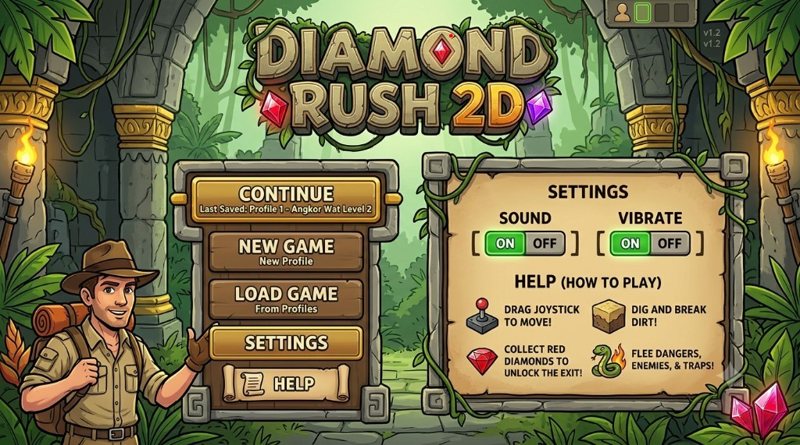
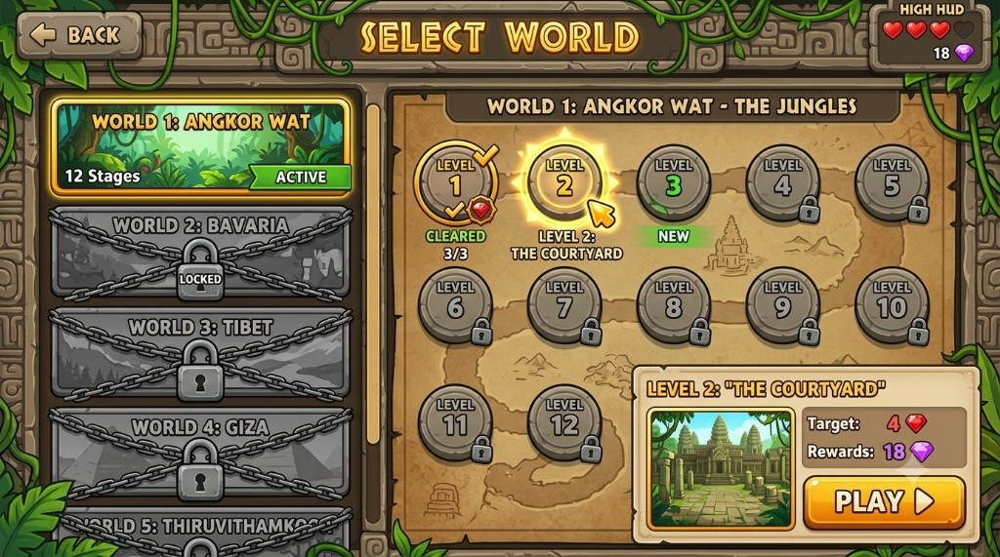
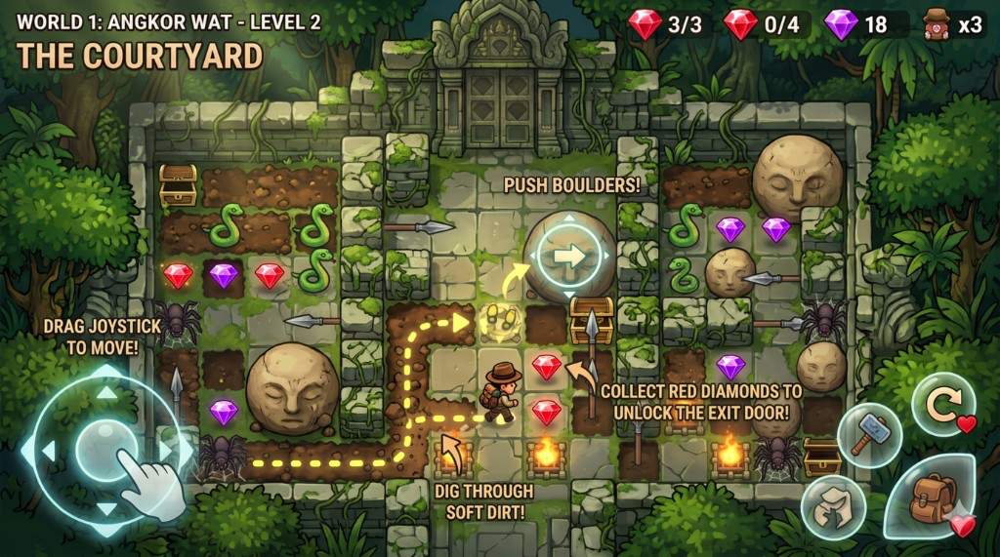

# Diamond Rush 2D — Game PRD

Source of truth for product, campaign, mechanics, and screen information architecture. Read this file before any major gameplay, level, economy, HUD, world, or menu change. Do not contradict it.

Layout metrics (canvas scaler, hit targets, thumb reach) live in [`.cursor/skills/diamond-rush-mobile-ui/SKILL.md`](../.cursor/skills/diamond-rush-mobile-ui/SKILL.md).

## Conflict order

1. This PRD wins on product, worlds, mechanics, campaign, and World Select information architecture.
2. The mobile-ui skill wins on canvas, hit targets, and Home compactness.
3. Do not invent mechanics, rename worlds, or skip the World 1 teaching order.

## 1. Product lock

| | |
| --- | --- |
| Platform | Mobile, landscape 16:9, touch. Portrait is off. |
| Genre | 2D grid puzzle-platformer / adventure |
| Camera | Oblique / top-down hybrid (Zelda-style). Grid math is orthogonal. Art is drawn at ~45°. Characters stand up. Walls show front faces. |
| Length | At least 2 hours |
| Campaign | **40 stages across 3 worlds**. World 1 is 12 stages (fully specified). Worlds 2–3 (28 stages) are TBD. |

Player is an explorer who navigates grid stages, collects diamonds, avoids traps, and uses tools.

## 2. Worlds

Canonical names. Do not use Amazon or Pyramids.

| World | Setting | v1 status |
| --- | --- | --- |
| 1. Angkor Wat | Jungles, overgrown temple ruins, deep greens, crumbling gray stone | 12 stages. Boss: **Jungle Guardian**. |
| 2. Bavaria | Dungeons: cold gray stone, frost, packed snow. Ice tiles change boulder movement. | Stage list TBD. Boss TBD. |
| 3. Tibet | Frozen caves, high-altitude ice hazards. | Stage list TBD. Boss TBD. |

Mockup Worlds 4–5 (Giza, Thiruvithamko) are **locked future slots**, not v1 gameplay. They may appear in the world list as locked.

World 1 starts unlocked. Worlds 2–3 unlock after the previous world’s boss.

## 3. Gameplay rules

- **Win a stage** by collecting the required red diamonds, then exiting through the unlocked door.
- **Grid tiles:** soft dirt (dig), unbreakable stone, cracked stone (Mystic Mallet only), pushable beige face-boulders.
- **Boulders** crush the player or enemies, block fire, and fall when supporting dirt is removed.
- **Checkpoint:** step on a glowing circular plate to save. The return button warps back at the cost of **1 life**.
- **Perfect clear** grants an extra life: all red diamonds, all purple diamonds, zero hits, no restart.
- **Each world ends in a boss.**

## 4. Economy and tools

| Item | Role |
| --- | --- |
| Red diamonds | Progression. Required count unlocks the exit. Extra reds count toward perfect clear. |
| Purple diamonds | Currency. Spend in the store for health upgrades. |
| Chests | Red or purple diamonds. Secret chests can grant extra lives. |
| Mystic Mallet | First special tool. Acquired World 1 Level 10. Breaks cracked stone. Sits in the right action cluster. |
| Compass | Named. Acquisition TBD. |
| Grappling Hook | Named. Acquisition TBD. |

## 5. Enemies and hazards

- Bright green patrolling snakes
- Spiders
- Fire traps
- Giant spears
- Face-boulders (physics hazard and puzzle tool)

## 6. Screens

### Home

- **Continue** (primary) with last-save subtitle.
- **New Game**
- **Load Game** — 3 profile slots.
- **Settings** — Sound ON/OFF, Vibrate ON/OFF. Modal on phone.
- **Help** — how to play. Modal on phone.

Do not ship the mockup’s always-on two-column help board. Settings and Help are modals. Continue / New Game / Settings stay on Home; Load Game and Help open as extra options, not a dense desktop board.

### World Select

- **Back** returns to Home.
- Left: world list. Locked worlds stay visible, not playable.
- Right: 12-node stage map for the selected world, plus a level detail card (name, target reds, purple reward, **PLAY**).
- Top-right wallet: lives + purple diamonds.
- Stage nodes: cleared, current/new, locked.

This list + map layout is the product target. Implement it with mobile hit targets and 16:9 metrics from the mobile-ui skill.

### Gameplay

- Left: transparent dynamic floating joystick.
- Right action cluster: Mystic Mallet (from L10), checkpoint return, inventory.
- Top HUD: required reds `n/n`, extra/optional reds, purple wallet, lives.
- Boss stages add a boss health bar to the top HUD.
- Exit door at the stage edge uses unlit diamond indentations until the required reds are collected.

The Level 2 mockup is overlay **style** reference. Shipping Level 2 must not show every hint at once.

## 7. Angkor Wat teaching order

Do not skip or reorder these beats.

| Levels | Zone | Teach |
| --- | --- | --- |
| 1–3 | The Courtyard | Move, dig soft dirt, collect required reds. Push boulders. Avoid snakes. No traps. |
| 4–6 | Overgrown Corridors | Crush snakes with boulders. Vertical boulder routing. Secret chests, purple diamonds, perfect clear. |
| 7–9 | Trap Rooms | Fire (block with boulders). Spears. Checkpoint return. Combined puzzle. |
| 10–11 | Inner Sanctum | Equip Mystic Mallet. Break cracked stone. High-density mix of dirt, boulders, snakes. |
| 12 | Jungle Guardian | Mallet, drop boulders on the boss, dodge spears / fire / snakes. Unlock the portal to World 2. |

Tutorial lines (one per introduction, not stacked):

- L1: “Move to Dig!”
- L2: “Push Boulders!”
- L3: “Avoid Snakes!”
- L4: “Crush Enemies!”
- L7: “Block the Flames!”
- L10: “Equip Mystic Mallet!”

## 8. Out of scope for v1

- Gameplay for Worlds 4–5
- Bavaria and Tibet stage lists
- Store UI details
- Compass and Grappling Hook acquisition timing
